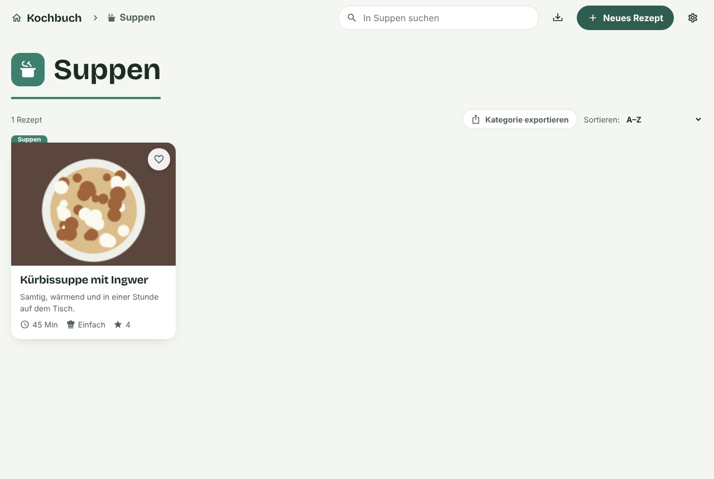
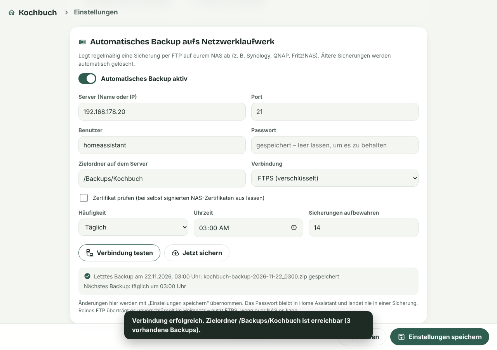
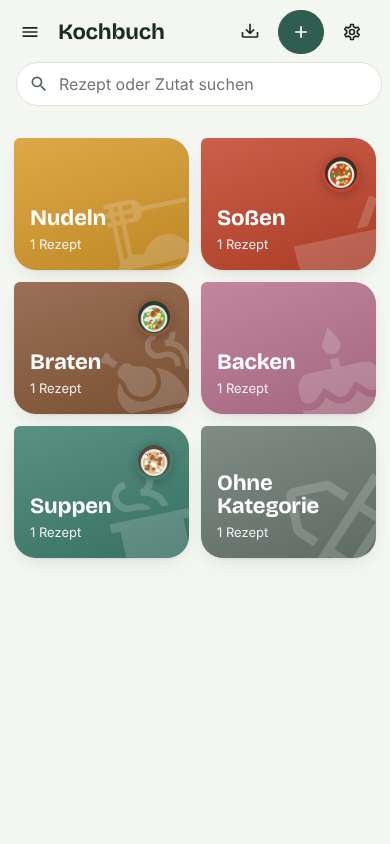
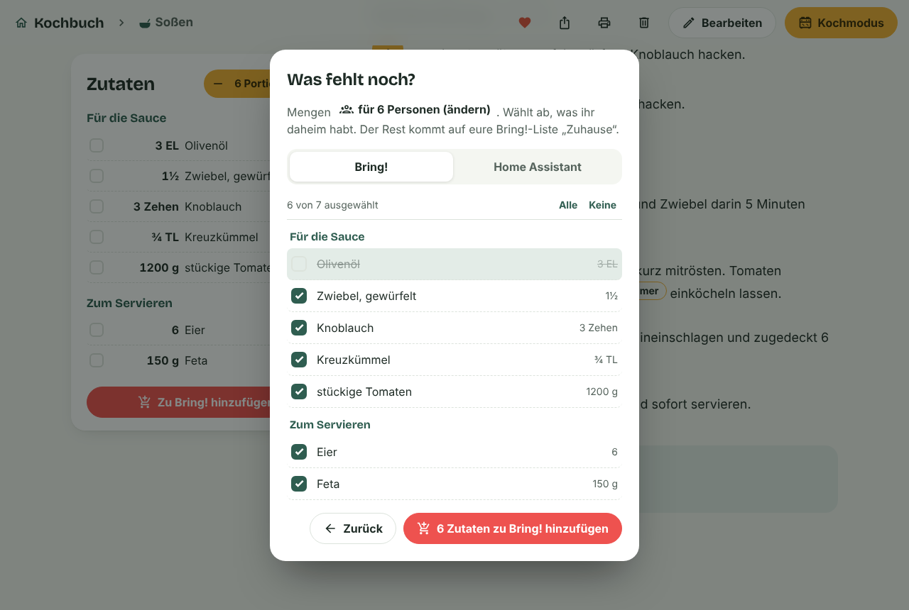
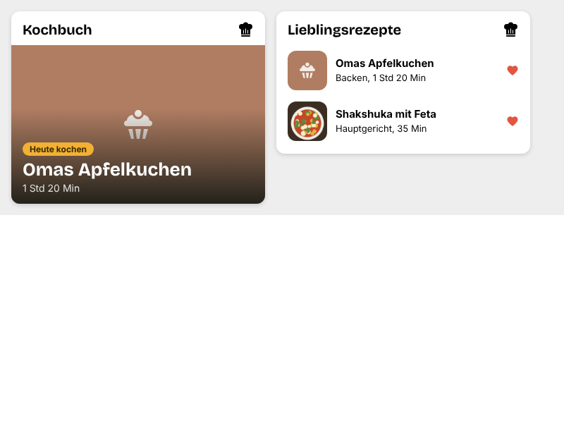

# Kochbuch für Home Assistant

Euer gemeinsames Rezeptbuch direkt in Home Assistant – mit eigener Seite in der Seitenleiste, Kochmodus fürs Küchentablet und Einkaufsliste per Knopfdruck.

 

## Was es kann

- **Rezepte sammeln** mit Foto, Kategorie, Schlagworten, Zeiten, Schwierigkeit, Bewertung, Zutaten (mit Zwischenüberschriften) und Arbeitsschritten
- **Startseite mit euren Kategorien** als große Kacheln – sonst nichts. Das Kochbuch startet leer, ohne Beispielrezepte
- **Kategorien mit Unterkategorien**: Vorspeisen; Hauptgericht (Nudel, Reis, Braten, Suppe, Soßen, Anderes); Beilage (Salat); Backen (Kuchen, Plätzchen); Nachspeise – alles in den Einstellungen änderbar
- **Favoriten zuerst**: mit dem Herz markierte Rezepte stehen in jeder Kategorie oben
- **Kategorien verwalten** in den Einstellungen: Haupt- und Unterkategorien hinzufügen, umbenennen, Farbe und Symbol wählen, Reihenfolge ändern, löschen (Rezepte einer gelöschten Kategorie werden in eine andere verschoben)
- **Rezeptlisten pro Kategorie** mit Suche (auch nach Zutaten) und Sortierung; oben führt „Kochbuch“ jederzeit zurück zur Startseite
- **Portionen umrechnen** – alle Mengen passen sich automatisch an (inkl. ½, ¼ …)
- **Verbindung zur Einkaufsliste-App** ([domiundergroun/Einkaufsliste](https://github.com/domiundergroun/Einkaufsliste)): Zutaten landen direkt auf eurer Einkaufsliste, grünes Lämpchen zeigt die Verbindung in beiden Apps
- **Bring!-Anbindung** (alternativ): in den Einstellungen mit dem Bring!-Konto anmelden und die Liste wählen; im Rezept „Zur Einkaufsliste hinzufügen“ fragt zuerst nach der Personenzahl, rechnet die Mengen um und zeigt alle Zutaten; ihr wählt ab, was daheim ist, der Rest landet in Bring!
- **Einkaufsliste in Home Assistant** (To-do-Liste) als Alternative oder zusätzlich
- **Zubereitung in zwei Teilen**: Vorbereitung (schneiden, abwiegen …) und Kochen, jeweils mit eigener Zeit
- **Kochmodus**: ein Schritt pro Bildschirm in großer Schrift, Bildschirm bleibt an, Zutaten daneben
- **Timer**: „20 Minuten“ im Text wird automatisch zum Timer-Knopf, mit Signalton
- **Import aus dem Internet**: Adresse von Chefkoch, Lecker, Foodblogs usw. einfügen – Rezept und Foto werden übernommen
- **Zutatenliste einfügen**: ganze Liste aus der Zwischenablage, wird automatisch in Menge/Einheit/Zutat zerlegt
- **Drucken** als schlichtes Rezeptblatt
- **Rezepte exportieren und importieren**: einzelne Rezepte, ganze Kategorien oder alle Rezepte als Datei (mit Fotos) weitergeben und übernehmen
- **Sicherung** als ZIP (Rezepte, Fotos, Kategorien, Einstellungen) herunterladen und wieder einspielen
- **Automatisches Backup aufs NAS** per FTP/FTPS, täglich oder wöchentlich, alte Sicherungen werden aufgeräumt
- **Dashboard-Karte** „Heute kochen“, Lieblingsrezepte oder neue Rezepte
- **Sensor** `sensor.kochbuch_rezepte` mit Anzahl, Favoriten und Rezept des Tages
- Hell- und Dunkelmodus, optimiert für Handy, Tablet und Desktop

## Installation

### Über HACS (empfohlen)

1. HACS öffnen → oben rechts ⋮ → **Benutzerdefinierte Repositories**
2. Repository `https://github.com/domiundergroun/Kochrezepte`, Typ **Integration** hinzufügen
3. „Kochbuch“ suchen und herunterladen
4. Home Assistant neu starten
5. **Einstellungen → Geräte & Dienste → Integration hinzufügen → Kochbuch**

Updates erscheinen danach automatisch in HACS.

### Manuell

Den Ordner `custom_components/kochbuch` nach `/config/custom_components/kochbuch` kopieren, Home Assistant neu starten und die Integration wie oben hinzufügen.

## Dashboard-Karte

```yaml
type: custom:kochbuch-card
mode: heute        # heute | favoriten | neu
title: Was kochen wir?   # optional
anzahl: 4          # bei favoriten/neu
```

„Heute“ wählt jeden Tag ein anderes Rezept (aus den Favoriten, sobald es mindestens fünf gibt). Ein Tipp auf ein Rezept öffnet es im Kochbuch.

## Wo liegen die Daten?

- Rezepte und Einstellungen: `/config/.storage/kochbuch.rezepte` (in jeder Home-Assistant-Sicherung enthalten)
- Fotos: `/config/kochbuch_bilder/`

## Versionen

| Version | Änderungen |
|---|---|
| 1.9.1 | In Unterkategorien steht die Oberkategorie wieder oben (z. B. Hauptgericht › Reis), antippbar |
| 1.9.0 | Einstellungen › Einkaufsliste: Ziel wählbar (Unsere Einkaufsliste, Bring! direkt, andere To-do-Liste); Verbindung zur Einkaufsliste-App mit grünem Lämpchen |
| 1.8.1 | Im Rezept heißt der Knopf jetzt „Zur Einkaufsliste hinzufügen“ (statt „Zu Bring! hinzufügen“); Dialog-Knöpfe passen aufs Handy |
| 1.8.0 | Neue Unterkategorie „Soßen“ unter Hauptgericht (wird bei bestehenden Installationen einmalig ergänzt) |
| 1.7.5 | Einstellungen: Sicherung und automatisches Backup in einem Bereich zusammengefasst |
| 1.7.4 | Startseite: Kacheln zeigen nur noch die Hauptkategorie, ohne Liste der Unterkategorien |
| 1.7.3 | Hauptkategorien zeigen nur ihre eigenen Rezepte, Rezepte der Unterkategorien nur dort (Suche findet weiterhin alles) |
| 1.7.2 | Keine Favoriten-Kacheln mehr; Favoriten stehen in jeder Rezeptliste oben |
| 1.7.1 | Unterkategorien zeigen nur noch sich selbst als Überschrift (Pfeil führt zur Oberkategorie zurück); Favoriten-Kachel in Unterkategorien nur, wenn dort Favoriten gesetzt sind |
| 1.7.0 | Neue Kategorie-Struktur (Vorspeisen, Hauptgericht mit Nudel/Reis/Braten/Suppe/Anderes, Beilage mit Salat, Backen mit Kuchen/Plätzchen, Nachspeise) inkl. automatischer Umstellung bestehender Rezepte; Favoriten in jeder Kategorie |
| 1.6.2 | Rezeptkarten überall gleich groß (lange Namen werden getrennt); Kopfzeile auf dem Handy: Suchfeld in eigener Zeile, Knöpfe brechen nicht mehr um |
| 1.6.1 | Abgehakte Zutaten rutschen ans Ende ihrer Gruppe; beim Abhaken springt die Seite nicht mehr nach oben |
| 1.6.0 | Einkaufen: erst Personenzahl wählen, dann umgerechnete Zutaten; Kategorie-Symbol statt Farbpunkt in Titel und Pfad |
| 1.5.0 | Unterkategorien (eine Ebene); neue Standard-Kategorien Kuchen und Plätzchen unter Backen sowie Salat; Einstellungen zeigen Kategorien als Baum |
| 1.4.1 | Handy: Kopfzeile der Rezeptansicht passt wieder aufs Display |
| 1.4.0 | Bring!-Anbindung mit Anmeldung und Listenauswahl; Auswahl-Dialog vor dem Hinzufügen der Zutaten; Einstellungen in einklappbaren Bereichen |
| 1.3.0 | Zubereitung getrennt in Vorbereitung und Kochen; Rezepte exportieren/importieren (einzeln, Kategorie, alle); Sicherung als ZIP mit Fotos; automatisches Backup per FTP aufs Netzwerklaufwerk |
| 1.2.0 | Startseite zeigt nur noch die Kategorien; Reiterleiste ersetzt durch „Kochbuch › Kategorie“ zum Zurückspringen; Kategorie beim Rezept ist Pflicht; beim Löschen einer Kategorie wählt ihr, wohin die Rezepte wandern |
| 1.1.0 | Startseite zeigt die Kategorien als Kacheln; Kategorien in den Einstellungen anlegen, bearbeiten, sortieren und löschen; neue Standard-Kategorien Nudeln, Soßen, Braten, Backen, Suppen |
| 1.0.1 | Handy: Suchfeld in eigener Zeile, Kopfzeile passt wieder aufs Display; Mengen wie 1/2 werden als ½ angezeigt; Karten-Schriften korrigiert |
| 1.0.0 | Erste Version: Rezeptverwaltung, Kochmodus, Timer, Einkaufsliste, Web-Import, Sicherung, Dashboard-Karte, Sensor |

## So sieht es aus

| Startseite | Rezept |
|---|---|
|  |  |
| **Kategorie** | **Kategorien verwalten** |
|  |  |
| **Kochmodus** | **Handy** |
|  |  |

Zutaten zu Bring! hinzufügen:



Dashboard-Karte:


