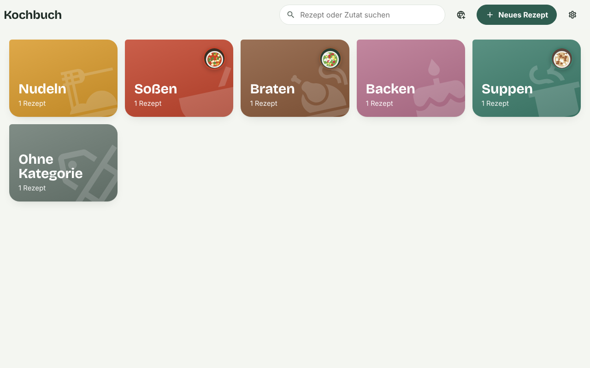
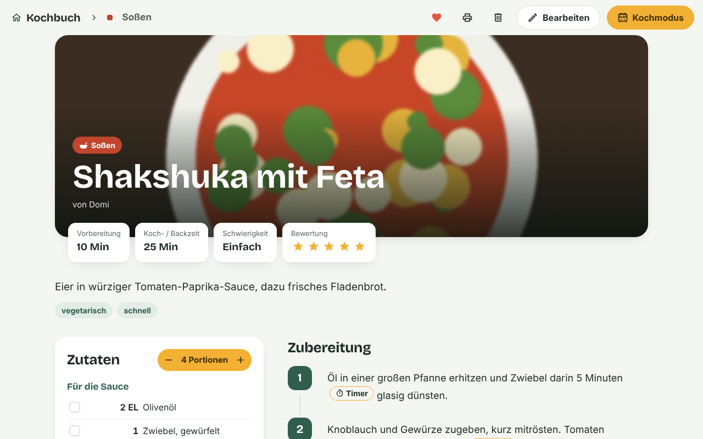
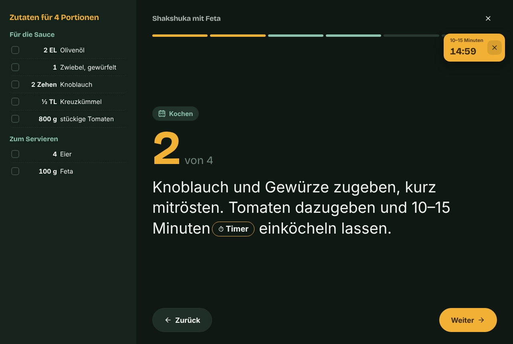

# Kochbuch für Home Assistant

Euer gemeinsames Rezeptbuch direkt in Home Assistant – mit eigener Seite in der Seitenleiste, Kochmodus fürs Küchentablet und Einkaufsliste per Knopfdruck.

 

## Was es kann

- **Rezepte sammeln** mit Foto, Kategorie, Schlagworten, Zeiten, Schwierigkeit, Bewertung, Zutaten (mit Zwischenüberschriften) und Arbeitsschritten
- **Startseite mit euren Kategorien** als große Kacheln – sonst nichts. Das Kochbuch startet leer, ohne Beispielrezepte
- **Kategorien verwalten** in den Einstellungen: hinzufügen, umbenennen, Farbe und Symbol wählen, Reihenfolge ändern, löschen (Rezepte einer gelöschten Kategorie werden in eine andere verschoben)
- **Rezeptlisten pro Kategorie** mit Suche (auch nach Zutaten) und Sortierung; oben führt „Kochbuch“ jederzeit zurück zur Startseite
- **Portionen umrechnen** – alle Mengen passen sich automatisch an (inkl. ½, ¼ …)
- **Einkaufsliste**: Zutaten antippen, die schon da sind – der Rest landet in eurer To-do-Liste (z. B. „Einkaufsliste“)
- **Kochmodus**: ein Schritt pro Bildschirm in großer Schrift, Bildschirm bleibt an, Zutaten daneben
- **Timer**: „20 Minuten“ im Text wird automatisch zum Timer-Knopf, mit Signalton
- **Import aus dem Internet**: Adresse von Chefkoch, Lecker, Foodblogs usw. einfügen – Rezept und Foto werden übernommen
- **Zutatenliste einfügen**: ganze Liste aus der Zwischenablage, wird automatisch in Menge/Einheit/Zutat zerlegt
- **Drucken** als schlichtes Rezeptblatt
- **Sicherung** herunterladen und wieder einspielen
- **Dashboard-Karte** „Heute kochen“, Lieblingsrezepte oder neue Rezepte
- **Sensor** `sensor.kochbuch_rezepte` mit Anzahl, Favoriten und Rezept des Tages
- Hell- und Dunkelmodus, optimiert für Handy, Tablet und Desktop

## Installation

### Über HACS (empfohlen)

1. HACS öffnen → oben rechts ⋮ → **Benutzerdefinierte Repositories**
2. Repository `https://github.com/domiundergroun/Kochrezepte`, Typ **Integration** hinzufügen
3. „Kochbuch“ suchen und herunterladen
4. Home Assistant neu starten
5. **Einstellungen → Geräte & Dienste → Integration hinzufügen → Kochbuch**

Updates erscheinen danach automatisch in HACS.

### Manuell

Den Ordner `custom_components/kochbuch` nach `/config/custom_components/kochbuch` kopieren, Home Assistant neu starten und die Integration wie oben hinzufügen.

## Dashboard-Karte

```yaml
type: custom:kochbuch-card
mode: heute        # heute | favoriten | neu
title: Was kochen wir?   # optional
anzahl: 4          # bei favoriten/neu
```

„Heute“ wählt jeden Tag ein anderes Rezept (aus den Favoriten, sobald es mindestens fünf gibt). Ein Tipp auf ein Rezept öffnet es im Kochbuch.

## Wo liegen die Daten?

- Rezepte und Einstellungen: `/config/.storage/kochbuch.rezepte` (in jeder Home-Assistant-Sicherung enthalten)
- Fotos: `/config/kochbuch_bilder/`

## Versionen

| Version | Änderungen |
|---|---|
| 1.2.0 | Startseite zeigt nur noch die Kategorien; Reiterleiste ersetzt durch „Kochbuch › Kategorie“ zum Zurückspringen; Kategorie beim Rezept ist Pflicht; beim Löschen einer Kategorie wählt ihr, wohin die Rezepte wandern |
| 1.1.0 | Startseite zeigt die Kategorien als Kacheln; Kategorien in den Einstellungen anlegen, bearbeiten, sortieren und löschen; neue Standard-Kategorien Nudeln, Soßen, Braten, Backen, Suppen |
| 1.0.1 | Handy: Suchfeld in eigener Zeile, Kopfzeile passt wieder aufs Display; Mengen wie 1/2 werden als ½ angezeigt; Karten-Schriften korrigiert |
| 1.0.0 | Erste Version: Rezeptverwaltung, Kochmodus, Timer, Einkaufsliste, Web-Import, Sicherung, Dashboard-Karte, Sensor |

## So sieht es aus

| Startseite | Rezept |
|---|---|
|  |  |
| **Kategorie** | **Kategorien verwalten** |
|  |  |
| **Kochmodus** | **Handy** |
|  |  |

Dashboard-Karte:


